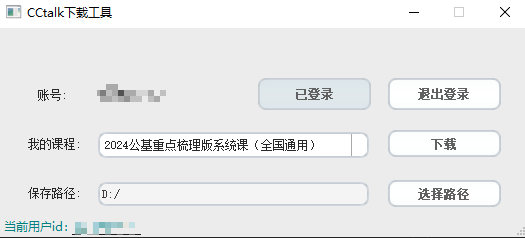
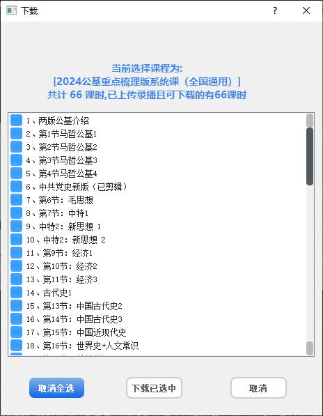
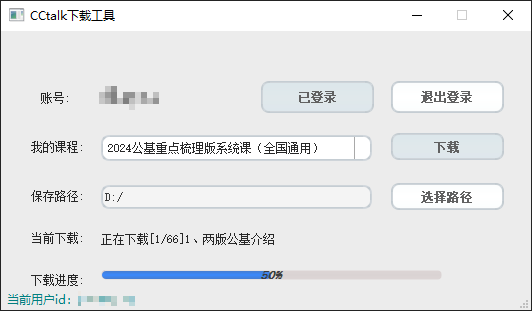

# CCtalk 网课下载

> **新版 [CCDown](https://prepare.ccdown.top:8443/)** 已发布。  
> **旧版（本仓库）** 主要能下**网页端就能播**的课；**仅客户端可播**的课，旧工具下不了。  
> **CCDown** 配合本机 CCTalk 桌面端，**网页能播与仅客户端能播的课都可以下载**（少数 H5 三分屏仍在适配）。

## 推荐：CCDown（当前主推）

- 介绍与下载：**<https://prepare.ccdown.top:8443/>**
- Windows 桌面版，向导式操作
- 浏览已购课 → 勾选批量下载 → 本地用第三方播放器观看
- 仅限**个人学习**；禁止二次分发、上传、出售或公开分享

**安装与使用**（摘要）：

1. 安装并登录 Windows 版 [CCTalk 桌面客户端](https://www.cctalk.com/download)
2. 从落地页下载 CCDown 压缩包，整包解压后运行 `CCDown.exe`
3. 首次启动需同意用户协议
4. 按界面：启动 CCTalk → 登录 → 播放任意一节 → 选课下载

Mac 版开发中。

---

## 本仓库：旧版工具（历史）

PyQt + pyppeteer，友好 GUI，一键下载。

**能力边界（相对新版）：**

| | 网页端可播放的课 | 仅客户端可播放的课 |
|--|--|--|
| **本仓库旧工具** | 支持 | **不支持** |
| **CCDown** | 支持 | **支持** |

旧版请勿用于商业用途；下载内容禁止二次分发，后果自负。需要下「仅客户端可播」的课时，请使用 [CCDown](https://prepare.ccdown.top:8443/)。

### 旧版使用方式

点击登录会弹出浏览器进入 cctalk 官网，正常登录后程序会自动获取用户信息。



「我的课程」为下拉框，选择课程后可解析课时列表并按需下载。



支持进度显示；已存在文件会跳过（不检查完整性）。



### 旧版开发

```bash
pip install -r requirements.txt
python ccdownload.py
```

---

## 链接

| | |
|--|--|
| **CCDown 下载 / 说明** | <https://prepare.ccdown.top:8443/> |
| 本仓库（旧客户端源码） | 当前仓库 |
